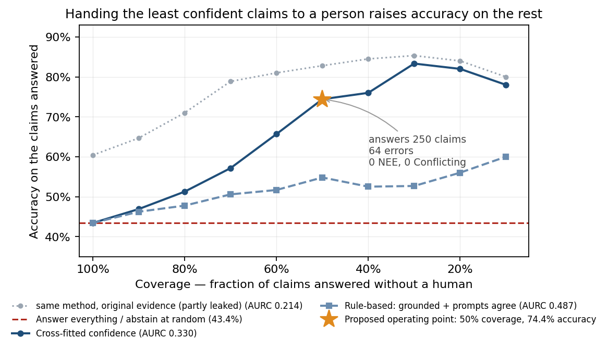
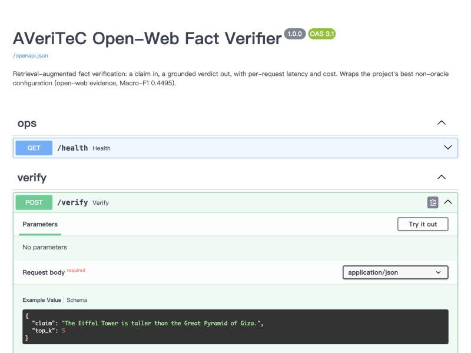

# What Actually Drives Retrieval-Augmented Fact Verification?

**A controlled study on AVeriTeC showing that *where* evidence comes from matters far more than *how* it is retrieved.**

Fact-checking with retrieval-augmented LLMs has three tunable components — the **evidence source**, the **prompt**, and the **retrieval strategy** — and most research pours effort into the last one (dense retrievers, query reformulation, decomposition). This project asks: *which one actually moves the needle?* By decoupling the pipeline and caching every stage, each experiment changes exactly one component, cleanly isolating its effect on 4-class veracity prediction (Supported / Refuted / Not Enough Evidence / Conflicting).

### Headline result

> **Evidence Source ≫ Prompt Design > Retrieval Strategy**

Climbing an evidence-availability ladder on the official 500-claim dev set (Macro-F1):

| Configuration | Macro-F1 | |
|---|---|---|
| Averaged Perceptron (no evidence) | 0.3546 | traditional baseline |
| LLM zero-shot (no evidence) | 0.3365 | reasoning alone isn't the bottleneck |
| BM25 closed-web + plain prompt | 0.3644 | curated Knowledge Store |
| **DuckDuckGo open-web + plain prompt** | **0.4495** | **+0.085, McNemar p = 2.5e-7** |
| Gold evidence (oracle) | 0.5633 | upper bound |

Switching the **evidence source** (closed → open web) gives the single largest gain (+0.085, statistically significant), closing 43% of the gap to the oracle ceiling. In contrast, swapping the **retrieval architecture** (BM25 → dense re-ranking) moves Macro-F1 by just −0.007 (within noise), and sophisticated query reformulation *hurts* (keyword −0.035, decomposition −0.042). A simpler **prompt** adds a secondary **+0.031** on the open web, where both prompts saw identical evidence. (An earlier version of this README also claimed +0.040 on the closed web; that comparison turned out to change the evidence as well as the prompt. [See the correction.](#a-correction-the-closed-web-prompt-rows-saw-different-evidence))

The retrieval result replicates on the stronger evidence rung: hybrid retrieval (BM25 + dense fused by RRF) and cross-encoder re-ranking over a widened open-web pool land at **p = 1.0 and p = 0.86** against the deployed baseline — [see the null result and the control that nearly hid it](#does-better-ranking-help-a-pre-registered-null-result).

### The change that actually paid: letting it abstain

No deployed fact-checking pipeline answers every claim — the model is triage, and a person handles the rest. Scored that way, the picture changes completely:



> Forced to answer all 500 dev claims, the system is **60.4%** accurate. Allowed to abstain, it answers **70% of claims at 78.9%** accuracy — cutting human review load by 70% — and the 30% it declines includes **every single *not enough evidence* verdict**, the class it is right about only 15% of the time.

That is worth more than every retrieval change in this project combined, and it needed no new retrieval, no new model and no extra API spend — only the confidence signals already on disk. [Details and the leakage control](#selective-prediction-how-much-work-can-it-take-off-a-human).

An **oracle-gap error analysis** (quantitative decomposition + a 20-case qualitative study, with 3 independent LLM annotators adjudicating the cases the first pass was unsure about) traces the residual error to the Conflicting class (54.6% of the gap) and an annotation-convention mismatch — and shows ~20% of the gap is irreducible annotation ambiguity, i.e. the gold ceiling is not ground truth.

**Stack:** Python · BM25 (rank-bm25) · sentence-transformers (mpnet) · DuckDuckGo · Azure OpenAI (`gpt-4.1-mini`) · FastAPI · Docker · scikit-learn · NLTK

## Full results

All configurations on the official 500-claim dev set (Macro-F1 + per-class F1). Regenerate this table from the committed caches with `python src/make_results_table.py` — no API calls needed.

| Evidence | Configuration | Macro-F1 | Supported F1 | Refuted F1 | NEE F1 | Conflicting F1 | n |
|---|---|---|---|---|---|---|---|
| No evidence | Majority baseline | 0.1894 | 0.000 | 0.758 | 0.000 | 0.000 | 500 |
|  | Random baseline | 0.1929 | 0.201 | 0.384 | 0.069 | 0.118 | 500 |
|  | Averaged Perceptron | 0.3546 | 0.357 | 0.758 | 0.218 | 0.085 | 500 |
|  | LLM zero-shot (no retrieval) | 0.3365 | 0.551 | 0.578 | 0.174 | 0.043 | 500 |
| Closed web | BM25 + standard prompt † | 0.3241 | 0.564 | 0.561 | 0.061 | 0.111 | 500 |
|  | BM25 + plain prompt | 0.3644 | 0.558 | 0.596 | 0.150 | 0.154 | 500 |
|  | Dense rerank + plain prompt ‡ | 0.3572 | 0.570 | 0.645 | 0.178 | 0.036 | 500 |
|  | BM25 + 8-shot ICL | 0.3754 | 0.541 | 0.632 | 0.102 | **0.226** | 500 |
| Open web | DuckDuckGo + standard prompt | 0.4180 | 0.674 | 0.659 | 0.214 | 0.125 | 500 |
|  | **DuckDuckGo + plain prompt** | **0.4495** | 0.712 | 0.711 | 0.237 | 0.138 | 500 |
| Oracle | Gold evidence | 0.5633 | 0.858 | 0.862 | 0.487 | 0.045 | 500 |

Reading down the three evidence rungs (closed → open → oracle) is the main result; the two prompt rows under *Open web* isolate the prompt effect at a fixed source; *Dense rerank* and *8-shot ICL* are the retrieval- and prompt-side ablations. Even under gold evidence, the **Conflicting** class stays near zero (F1 0.045) — the motivation for the error analysis below.

† and ‡ mark rows with a known defect, explained next. Every other closed-web row showed the LLM the same thing: five BM25 passages, each cut to its **first 300 characters**.

### A correction: the closed-web prompt rows saw different evidence

An earlier version of this README singled out `BM25 + standard prompt` (0.3241) as scoring *below* the no-retrieval LLM (0.3365). It read that as "adding evidence made the system worse, and the plain prompt (0.3644) rescues the same retrieval". **That comparison is confounded, and the claim is withdrawn.**

The two rows share a ranking but not the text the model saw:

| Row | How it was produced | What the LLM was shown |
|---|---|---|
| standard prompt (0.3241) | `bm25_baseline.py`, live | **Full ~1,100–1,400-char chunks**. `build_user_input` *stops* at the first passage that would cross 3,000 characters, which here is almost always after the **second**. |
| plain prompt (0.3644) | `reprompt_eval.py`, re-prompted from the result cache | **All five passages as 300-char previews**. The cache stored `p[:300]` to save space, and re-prompting reads the cache. |

So "BM25 top-5" meant two full passages in one row and five 300-character slices in the other. On the 16 claims recomputed so far, all 16 saw exactly 2 passages under the standard run. Across all 495 claims with evidence, that run's prompt sizes (median 712 tokens, p10–p90 639–785) sit inside the range of those 16 (631–762). The 0.040 gap mixes a prompt change with a change in how much evidence was shown, and the two cannot be separated from these runs. The clean prompt comparison is the open-web pair, where both prompts saw the same five snippets: **+0.031**. A 2×2 (prompt × evidence view) re-run on the closed corpus would settle it.

‡ **Dense rerank used stale candidate pools for 17 of 500 claims.** The ranking cache was keyed by corpus *name*, not corpus *content*. When the dev corpus caches were rebuilt in June, 270 depth-10 and 17 depth-30 ranking caches computed against the previous build kept being served as hits, and the dense run re-ranked those 17 stale pools (claim_0 … claim_32). The published BM25 rankings are not affected: recomputed from the current corpus, they match exactly. Ranking-cache entries now carry a content stamp of the corpus they were computed on, and a mismatch is a miss (`corpus_stamp()` in `bm25_baseline.py`, regression-tested). The dense number has not been re-run, so read 0.3572 as provisional: 17 of its 500 predictions (3.4%) rest on a stale pool.

## Faithfulness (is the verdict grounded, or hallucinated?)

Macro-F1 measures whether a verdict is **correct**; it says nothing about whether the verdict is **grounded in the evidence actually retrieved**. A fact-checker that guesses right from the model's parametric memory is still unsafe. `src/rag_eval.py` adds a RAGAS-style **faithfulness** metric via an LLM-as-judge: given *only* the retrieved evidence and the system's verdict, is that verdict justified?

Faithfulness across the full evidence ladder (all 500 official dev claims, judge = `gpt-4.1-mini`):

| Verdict | Closed-web (BM25) | Open-web (DDG) | Gold (oracle) |
|---|---|---|---|
| Supported | 0.726 | 0.803 | 0.800 |
| Refuted | 0.760 | 0.861 | 0.884 |
| NEE | 0.484 | 0.522 | 0.659 |
| Conflicting | 0.500 | 0.600 | 0.667 |
| **Overall** | **0.637** | **0.753** | **0.822** |

<sub>Judged on 487 / 485 / 488 claims respectively; 9–12 per config are dropped where Azure's content filter blocks the judge call. Faithfulness is the share of verdicts the judge rules justified *by the evidence shown* (not by real-world truth).</sub>

Two findings this adds on top of accuracy — one survived a human check, one did not:

1. **Faithfulness climbs the same evidence ladder as accuracy** — 0.637 → 0.753 → 0.822, mirroring Macro-F1's 0.364 → 0.450 → 0.563. *Provisional:* all three columns were scored by the original judge, which the check below found to be biased against one verdict class, and the classes are not equally common on every rung. Re-scoring the closed-web and gold columns with the corrected judge would settle it.
2. ~~"Not enough evidence" is the least-grounded verdict at every rung.~~ **Withdrawn.** This was mostly the judge's own error, not the system's: on the open web, the corrected judge rates 90% of NEE verdicts as grounded, not 52%. See below.

### How far can the judge be trusted? A blind human check

An LLM judge is a model, and its numbers are only as good as its agreement with a person. So 50 open-web verdicts were labelled by hand with the judge's own rule, **blind to the judge's answer and to the gold label**: 25 the judge had called faithful and 25 it had called unfaithful, each shown with exactly the five snippets the judge saw (`judge_check/`).

| | Original judge (v1) | Corrected judge (v2) |
|---|---|---|
| Agrees with the person, on the 50 | 26 / 49, κ = 0.05 | 38 / 49, κ = 0.38 |
| … on *not enough evidence* verdicts | **4 / 14** | **12 / 14** |
| … on *supported* / *refuted* | 21 / 32 | 23 / 32 |
| Estimated agreement on all 485 verdicts | 66% | 79% |
| Faithfulness rate it reports | 75% | 84% |

<sub>One item marked "can't tell". Estimates re-weight the 50/50 sample to the judge's real 365 / 120 split. The person's own labels imply a faithfulness rate of about 79%.</sub>

**What went wrong.** The disagreement sat almost entirely in one class: the person judged all 14 *not enough evidence* verdicts justified, the judge only 4. On re-reading the 10 disputed cases, **9 had five snippets that never mention the claim at all** — 2024 debate coverage for a claim about 2020, police statistics for the wrong year, a currency-forgery tip for a different method. And 8 of those 10 claims have a *supported* or *refuted* gold label. The judge was answering from **its own knowledge of the claim**, against an instruction that told it not to: it knew the real answer, so it marked the system down for not giving it.

**The fix** (`--judge-version v2` in `src/rag_eval.py`) says it outright: use no outside knowledge, and if the passages never address the claim's specific point, *not enough evidence* is faithful — while keeping the other direction (if the passages *do* settle the claim, that verdict is unfaithful). Over all 485 open-web verdicts it moved exactly where it should: 45 NEE verdicts to faithful and only 2 the other way, against 6 changes among 142 *supported* verdicts. It also became slightly stricter on *refuted* (13 → unfaithful, 3 → faithful); on the checked sample that direction still agreed with the person (14 → 15 of 20).

**Read these with three caveats.** (1) The v2 prompt was written *after* reading these 50 disagreements, so its agreement on the same 50 is in-sample and optimistic; a fresh sample would be the honest test. (2) κ = 0.38 is "fair", not reliable — the judge went from chance-level to usable, not to trustworthy, and it now *over*-reports faithfulness by about 5 points. (3) One annotator, who formed their own verdict before comparing (slightly stricter than the rule on genuinely ambiguous evidence) and answered the last ~15 items much faster than the first.

**What this changes elsewhere.** The abstention layer used the judge's verdict as one of its signals, so it was re-run three ways: with the v1 judge AURC 0.214, with v2 0.216, with **no judge at all 0.223** — all far from random abstention's 0.396, and 78.9–79.1% accuracy at 70% coverage either way. The headline abstention result does not rest on the flawed judge. And the NEE weakness the accuracy analysis finds (below) is real, but it is mostly a **retrieval** failure: the system usually says "not enough evidence" because the search found nothing relevant, which is the honest answer to bad evidence.

Reproduce (the gold column first materializes gold QA pairs into retrieval-cache shape, then runs the same judge):

```bash
# Open-web column
python src/rag_eval.py \
    --retrieval-cache results/ddg_direct_dev500_retrieval_cache.json \
    --prediction-cache results/ddg_direct_dev500_plain_eval_cache.json \
    --output-cache results/faithfulness_ddg_plain_dev500.json

# Gold (oracle) column
python src/build_gold_evidence_cache.py \
    --data-file data/dev.json \
    --output-cache results/gold_evidence_dev500_retrieval_cache.json
python src/rag_eval.py \
    --retrieval-cache results/gold_evidence_dev500_retrieval_cache.json \
    --prediction-cache results/gold_baseline_official_dev_with_metadata_cache.json \
    --output-cache results/faithfulness_gold_plain_dev500.json

# The human check of the judge, and the corrected judge
python src/rag_eval.py --judge-version v2 \
    --retrieval-cache results/ddg_direct_dev500_retrieval_cache.json \
    --prediction-cache results/ddg_direct_dev500_plain_eval_cache.json \
    --output-cache results/faithfulness_ddg_plain_dev500_judge_v2.json
python src/score_judge_check.py --answers judge_check/answers_human.json             # v1
python src/score_judge_check.py --answers judge_check/answers_human.json \
    --judge-cache results/faithfulness_ddg_plain_dev500_judge_v2.json \
    --out results/judge_check_report_v2.json                                         # v2
```

## Selective prediction: how much work can it take off a human?

Macro-F1 scores a system that *must* answer. Full Fact, Meta's third-party programme and every content-moderation stack use the model as **triage** instead: it handles what it is confident about and routes the rest to a person. The operative question is therefore not "how accurate is it?" but *at what coverage can it run unattended, and at what accuracy?*

`src/selective_prediction.py` ranks claims by confidence and reports accuracy over the fraction answered. Three signals, all available at inference time on an unseen claim:

| Signal | What it costs | Accuracy when it fires |
|---|---|---|
| Faithfulness judge says the verdict is grounded | 1 extra LLM call | 0.685 (365 claims) vs 0.358 when it says ungrounded |
| A second prompt reaches the same verdict | 1 extra LLM call | 0.636 (451) vs 0.306 on disagreement |
| The predicted class itself | free | **`refuted` 0.853** (218) · `supported` 0.662 · `conflicting` 0.200 · **`NEE` 0.154** |

The third is the strongest and the most actionable: *"never auto-answer **not enough evidence**"* is a one-line shipping policy worth more than any ranking change tested here.

| Coverage | Answered | Accuracy | Errors | Supported | Refuted | NEE | Conflicting |
|---|---|---|---|---|---|---|---|
| 100% | 500 | 0.6040 | 198 | 142 | 218 | 117 | 20 |
| 90% | 450 | 0.6467 | 159 | 142 | 218 | 70 | 17 |
| 80% | 400 | 0.7100 | 116 | 142 | 218 | 25 | 12 |
| **70%** | **350** | **0.7886** | **74** | 132 | 218 | **0** | **0** |
| 50% | 250 | 0.8280 | 43 | 35 | 215 | 0 | 0 |
| 30% | 150 | 0.8533 | 22 | 0 | 150 | 0 | 0 |

**AURC 0.214 against 0.396 for abstaining at random** — the confidence ordering removes roughly half the area under the error curve.

**The leakage control.** Combining those signals needs a fitted model, and fitting it on the same 500 claims it is then scored on would mean the "never trust NEE" rule was learned from the very claims used to report its benefit. Every score above is therefore **cross-fitted**: 5-fold, each claim scored by a model fitted on the other folds only. A *fitted-nothing* rule (grounded + prompts agree, no labels touched at any point) is reported alongside and still reaches AURC 0.308 — weaker, but it confirms the signal is not an artifact of the fitting. This is still dev data the project has developed against, so the honest framing is **out-of-fold on dev**, not held-out test.

**Where the curve stops helping.** Below ~30% coverage accuracy flattens and then falls. That is not noise to be smoothed away: the features take only a dozen distinct values, so once everything but `refuted` has been filtered out there is nothing left to rank *within* that class. More coverage reduction would need a finer-grained confidence signal, such as token log-probabilities.

```bash
python src/selective_prediction.py \
    --predictions   results/ddg_direct_dev500_plain_eval_cache.json \
    --faithfulness  results/faithfulness_ddg_plain_dev500.json \
    --second-prompt results/ddg_dev500_nee_guard_eval_cache.json \
    --out results/selective_prediction_dev500.json
python src/plot_risk_coverage.py \
    --report results/selective_prediction_dev500.json \
    --out docs/risk_coverage.png
```

## Does better ranking help? A pre-registered null result

The headline claims retrieval strategy matters least. That was shown on the *closed* Knowledge Store, where a weak source could plausibly have masked a good ranker. This section tests the claim where it is hardest to dismiss: on the **open web**, the stronger source and the one the live service actually uses.

`src/hybrid_retrieval.py` widens the candidate pool from 5 to ~16 hits per claim and re-ranks it five ways — the engine's own order, Okapi BM25, dense cosine (mpnet), **Reciprocal Rank Fusion** of all three, and RRF followed by a **cross-encoder** (`ms-marco-MiniLM-L-12-v2`). Every variant reads the *same* cached pool, so a difference comes from ranking alone and not from different pages having been fetched on a different day.

Pilot on 150 dev claims, identical plain prompt throughout, significance by exact McNemar on accuracy (content-filtered claims excluded; `n` varies with the union of refusals):

| Ranking | Macro-F1 | Accuracy | NEE predicted | Conflicting predicted | vs. baseline |
|---|---|---|---|---|---|
| **Deployed baseline** (DDG top-5, narrow fetch) | 0.4171 | 0.6164 | 29 | 4 | — |
| Wide pool, engine order | 0.3537 | 0.5548 | 34 | 2 | −0.063, p = 0.14 |
| RRF (engine + BM25 + dense) | 0.4207 | 0.6164 | 20 | 10 | +0.004, **p = 1.0** |
| RRF + cross-encoder | 0.4440 | 0.6233 | 17 | 9 | +0.027, p = 0.86 |

**Hybrid retrieval buys nothing here.** RRF lands on *exactly* baseline accuracy (12 claims each way, p = 1.0); the cross-encoder adds a Macro-F1 point or three that does not survive the test. On this evidence rung too, retrieval strategy is the lever that does not move.

Three things are worth more than the null itself:

**The control you pick decides the answer.** Asking DuckDuckGo for 30 results makes its *own top 5 worse* than asking for 5 (Macro-F1 0.4171 → 0.3537, −0.062 accuracy). Scored against that wide-pool head — the control a "pool then re-rank" study reaches for by default — re-ranking looks like a solid **+0.065 to +0.090 Macro-F1**. Scored against the system actually deployed, it is ~0.00 to +0.027 and insignificant. The same runs, a 2–3× difference in the apparent gain, and only the second comparison answers "should I ship this?". The in-pool control is reported above as *Wide pool, engine order* rather than quietly dropped.

**Re-ranking does change behaviour — just not accuracy.** Every re-ranked variant cuts over-prediction of *not enough evidence* (29 → 17) and roughly doubles *Conflicting* predictions (4 → 9). The movement is real and consistent; it lands in the two rare classes, which is why Macro-F1 shifts while accuracy does not.

**A broken model is not a null result.** The first run had `rrf_ce` byte-identical to `rrf` across all 150 claims. The cause was not re-ranking being useless: `ms-marco-MiniLM-L-6-v2` emits NaN from its first encoder block in this environment, NaN compares `False` against everything, so `sorted()` returned its input and the re-ranker became the identity function — while running to completion and printing a plausible table. `assert_cross_encoder_works()` now rejects NaN, constant and inverted scorers at startup, and a per-call guard raises. Before reporting "no difference", prove the intervention changed its input.

### Reducing unjustified "not enough evidence"

*Not enough evidence* is the system's least accurate verdict. Quantified on dev500: the open-web system answers *not enough evidence* on **116 claims where only 18 truly are** — 84% of its NEE verdicts are wrong. `--prompt-style nee_guard` adds one paragraph defining when the label is warranted (evidence *silent* on the claim, not merely incomplete).

Full dev500, 491 claims after excluding content-filter refusals:

| Prompt | Macro-F1 | Accuracy | NEE predicted | Refuted F1 |
|---|---|---|---|---|
| plain | 0.4499 | 0.6049 | 116 | 0.711 |
| plain + NEE guard | 0.4611 | 0.6293 | 95 | 0.745 |

**+0.024 accuracy at p = 0.050 — borderline, and not claimed as significant.** The mechanism is the interesting part: of the 25 claims pushed off NEE, **14 become correct**, and **17 of the 25 were gold *Refuted*** — the guard mostly recovers refutations the model was hedging on, which is where the Refuted F1 gain comes from. Cost, as predicted: NEE's own F1 slips 0.238 → 0.231.

Two side effects worth recording. The longer prompt tripped Azure's content filter on 5 more claims (3 → 8 refusals); those are moderation decisions, not reasoning errors, so `compare_runs.py --exclude-filtered` drops the union and **both versions are reported** (without exclusion: +0.016 accuracy, p = 0.26). And the two NEE interventions **do not stack** — combining re-ranking with the guard drives NEE predictions down to 11, lifts accuracy +0.027, but returns Macro-F1 to baseline (−0.001) because true NEE recall collapses (F1 0.105). Two independently helpful suppressors over-correct together.

**Nothing from this week was shipped into `src/service.py`.** No variant cleared significance against the deployed configuration, and the honest conclusion is to leave a working system alone.

```bash
# 1. candidate pool (network-bound, ~20 min for 150 claims; cached per query)
python src/hybrid_retrieval.py --data-file data/dev.json --sample 150 \
    --pool-file results/hybrid_dev150_pool30.json --pool-only

# 2. all five rankings from that pool (no network)
python src/hybrid_retrieval.py --data-file data/dev.json --sample 150 \
    --pool-file results/hybrid_dev150_pool30.json \
    --out-prefix results/hybrid_dev150

# 3. score each under the same prompt, then compare with significance
python src/reprompt_eval.py --data-file data/dev.json \
    --retrieval-cache results/hybrid_dev150_rrf_ce_retrieval_cache.json \
    --output-cache    results/hybrid_dev150_rrf_ce_eval_cache.json
python src/compare_runs.py --restrict-to-common --exclude-filtered \
    --caches results/ddg_direct_dev500_plain_eval_cache.json \
             results/hybrid_dev150_rrf_ce_eval_cache.json \
    --labels baseline rrf_ce
```

## Live service (`POST /verify`)

The evaluated open-web pipeline is also exposed as a small **FastAPI** service, so a claim can be verified over HTTP and get back a grounded verdict with its evidence, latency and cost. The service calls the *same* retrieval, prompt and LLM code as the experiments (`src/service.py` is a thin wrapper), so what it serves is the project's best non-oracle configuration, not a re-implementation.

```bash
uvicorn src.service:app --port 8000      # then open http://localhost:8000/docs
```



```bash
curl -s -X POST http://localhost:8000/verify \
  -H "Content-Type: application/json" \
  -d '{"claim": "The Eiffel Tower is taller than the Great Pyramid of Giza."}'
```

```json
{
  "verdict": "supported",
  "verdict_label": "Supported",
  "evidence": [
    {
      "url": "https://www.britannica.com/topic/Eiffel-Tower-Paris-France",
      "title": "Eiffel Tower | History, Height, & Facts | Britannica",
      "snippet": "...it was twice as high as the dome of St. Peter's in Rome or the Great Pyramid of Giza..."
    }
  ],
  "n_evidence": 5,
  "latency": { "retrieval_ms": 7173.6, "llm_ms": 1475.7, "total_ms": 8649.3 },
  "usage": { "prompt_tokens": 598, "completion_tokens": 1, "cost_usd": 0.000241 }
}
```

- **`POST /verify`** — claim → open-web retrieval → LLM → grounded verdict + evidence, **timed and costed per request**. Request is Pydantic-validated (`claim` 3–2000 chars, `top_k` 1–10).
- **`GET /health`** — liveness, and which model/evidence source is wired.
- **`GET /docs`** — interactive Swagger UI (shown above).

`tests/test_service.py` mocks retrieval and the LLM, so the service is tested with no network or credentials. Measured latency and cost are in **Measured performance** below.

## Running in Docker

```bash
cp .env.example .env        # add your Azure OpenAI credentials
docker compose up --build
```

```bash
curl -s -X POST http://localhost:8000/verify \
  -H 'Content-Type: application/json' \
  -d '{"claim": "The Eiffel Tower is taller than the Great Pyramid of Giza."}'
```

Three deliberate choices in the image:

- **A slim runtime dependency set.** It installs `requirements-service.txt`, not `requirements.txt`: `sentence-transformers`/`torch` are pulled in only by `dense_rerank.py`, a retrieval ablation the service never imports. Leaving them out keeps the built image at **873 MB**.
- **NLTK corpora baked in.** `bm25_baseline.py` builds a stopword set *at import time*, so without them the service raises `LookupError` on startup — and the non-root user could not download them at run time.
- **Secrets stay out.** Credentials are read from `.env` at run time; `.dockerignore` keeps `.env`, the 20 MB `data/` directory and all caches out of the build context.

The container runs as a non-root user, declares a `/health` healthcheck, and keeps the per-query search cache in a named volume so restarts start warm.

Verified on the built image: it reports `healthy`, runs as uid 10001, answers `POST /verify` end to end, and the cache volume survives `docker compose restart` — retrieval on a repeated claim drops from 7 796 ms to 0.5 ms.

## Measured performance

`src/benchmark.py` drives the running service over HTTP and reports a distribution rather than one lucky request. 20 dev claims, two passes — the second hits the warm search cache:

| Pass | Retrieval p50 | Retrieval p95 | LLM p50 | LLM p95 | Total p50 | Total p95 |
|---|---|---|---|---|---|---|
| Cold | 6 643 ms | 7 628 ms | 1 142 ms | 1 842 ms | 8 168 ms | 9 131 ms |
| Warm | 2 ms | 2 ms | 971 ms | 1 357 ms | **972 ms** | **1 358 ms** |

Cost is unaffected by caching, since the LLM call still runs: **\$0.000240 per claim** — about **\$0.24 per 1 000 verifications** — at ~590 prompt tokens and a one-token completion. 40/40 requests succeeded.

Two things this makes concrete:

1. **Retrieval, not the model, is the cold-path bottleneck** — 81% of total latency. That is a deliberate trade: open-web search is throttled to stay ban-safe.
2. **The cache is worth 8.4× end to end** (8 168 → 972 ms p50). Once warm the service is LLM-bound and sub-second at p50, which is what a deployment with repeat traffic would actually see.

```bash
uvicorn src.service:app --port 8000
python src/benchmark.py --n 20 --repeat --out results/benchmark.json
```

## Setup

```bash
pip install -r requirements.txt
python -c "import nltk; nltk.download('punkt'); nltk.download('stopwords')"
```

Create a `.env` in this directory with Azure OpenAI credentials (never committed):

```
AZURE_OPENAI_ENDPOINT=...
AZURE_OPENAI_API_KEY=...
AZURE_OPENAI_DEPLOYMENT=gpt-4.1-mini
```

## Data

All AVeriTeC splits used by the reported experiments are committed under `data/` (~20 MB total), so the repo reproduces out of the box:

- `train.json`, `dev.json` — official AVeriTeC train / dev
- `internal_train.json`, `internal_dev.json` — our stratified split of train (via `src/split_data.py`)
- `internal_dev_sample150.json` — stratified 150-claim ablation subset
- `fewshot_clean8_pragref.json`, `fewshot_template.json` — few-shot ICL artifacts

Only the AVeriTeC **Knowledge Store** (used for closed-web BM25) is not committed due to size — download it via `src/download_ks.py` (kept local).

## Evaluation contract: run directories and a CI gate

The pipeline **writes artifacts and never scores itself**. One script, `eval_verdict.py`, owns the metric and reads those artifacts, so a metric fix re-scores every past run without touching the LLM.

```
runs/<run_id>/
  config.yaml        every knob, plus git commit and dirty flag
  retrieved.jsonl    claim_id, rank, passage_id, score
  passages.jsonl     passage_id -> url, title, text (deduplicated)
  predictions.jsonl  claim_id, gold_label, raw_output, used_passage_ids
  system.jsonl       claim_id, tokens, latency, status
  metrics.json       written only by eval_verdict.py
```

**`passage_id` is a content hash of (url, text)**, not a rank or row number, so the same passage carries the same id in every run that retrieved it. That makes runs comparable passage by passage.

The five committed runs re-derive the published numbers exactly (pinned by `tests/test_runs.py`):

```bash
python src/eval_verdict.py --run runs/bm25_dev500_plain       # 0.3644  95% CI [0.319, 0.408]
python src/eval_verdict.py --run runs/ddg_dev500_plain        # 0.4495  95% CI [0.406, 0.495]
python src/eval_verdict.py --run runs/gold_dev500_oracle      # 0.5633  95% CI [0.524, 0.607]
```

The bootstrap intervals are worth a look: the closed- and open-web intervals don't overlap, which is the evidence-source finding seen from a second angle. `bm25_dev500_plain` and `bm25_dev500_standard` have byte-identical `retrieved.jsonl` files. That makes the shared *ranking* checkable, and it is also what surfaced the correction above: the same ranking was shown to the model as different text.

**CI gate** (`src/ci_gate.py`, `.github/workflows/ci.yml`): every candidate in `ci/gate.yaml` must pass breakage checks on a fixed 30-claim set, with no API calls. The checks cover unparseable replies, collapse onto one label, a gross accuracy drop, missing claims, and an "identical to baseline" warning, which is how the NaN cross-encoder looked. Thirty claims cannot detect a one-point regression, and the gate doesn't pretend to. It decides whether a candidate deserves a McNemar test on dev500.

## How to reproduce the headline numbers

All results are cached in `results/*.json`; the commands below regenerate them. The pipeline is **decoupled**: retrieval writes a cache, then `reprompt_eval.py` runs the LLM on it — so a prompt ablation never re-retrieves.

```bash
# 1. Traditional baseline (no evidence)
python src/train_perceptron.py            # → averaged perceptron, Macro-F1 0.3546
python src/eval_week1_official_500.py

# 2. LLM zero-shot, no retrieval  (metadata is on by default; --sample -1 = full split)
python src/llm_baseline.py --split official_dev --sample -1

# 3. Closed-web: BM25 over the Knowledge Store (retrieval, then LLM)
WARMUP_WORKERS=2 python src/warmup_dev_corpus.py   # ~10 h, resumable; needs the KS mounted
python src/bm25_baseline.py --split official_dev --sample -1 --retrieval-only
python src/reprompt_eval.py \
    --data-file data/dev.json \
    --retrieval-cache results/bm25_baseline_official_dev_with_metadata_top5_cache.json \
    --output-cache results/bm25_official_dev_plain_prompt_cache.json   # 0.3644

# 4. Open-web: DuckDuckGo (the +0.085 result)
python src/open_web_baseline.py \
    --data-file data/dev.json \
    --output-cache results/ddg_direct_dev500_retrieval_cache.json --sample -1
python src/reprompt_eval.py \
    --data-file data/dev.json \
    --retrieval-cache results/ddg_direct_dev500_retrieval_cache.json \
    --output-cache results/ddg_direct_dev500_plain_eval_cache.json     # 0.4495

# 5. Oracle upper bound
python src/gold_baseline.py --split official_dev --sample -1           # 0.5633

# 6. Prompt ablation (Finding: plain > standard, replicates across sources)
python src/reprompt_eval.py --data-file data/dev.json \
    --retrieval-cache results/ddg_direct_dev500_retrieval_cache.json \
    --output-cache results/ddg_direct_dev500_standard_eval_cache.json --prompt-style standard

# 7. Error analysis (oracle gap decomposition + qualitative case dump)
python src/analyze_gold_gap.py
python src/prep_gold_gap_cases.py
```

## Tests

Minimal unit tests cover the pure, high-traffic components every reported number depends on — the places where a silent bug would corrupt a published number rather than crash. 104 tests, no network, no model downloads, no Knowledge Store; CI runs them on every push:

```bash
python tests/test_core.py        # label normalization, atomic writes, few-shot schema, cache integrity
python tests/test_service.py     # service: validation, verdict mapping, cost arithmetic (fully mocked)
python tests/test_hybrid.py      # RRF maths, BM25 edge cases, re-ranker guards, exact McNemar
python tests/test_selective.py   # risk-coverage maths, AURC, tie handling, cross-fit leakage
python tests/test_runs.py        # run contract, verdict scoring, CI gate, and the
                                 # published numbers re-derived from runs/
python tests/test_demo.py        # the demo page's numbers match the published report
python tests/test_judge_check.py # faithfulness-judge check: blindness, re-weighting maths
# or:  pytest tests/
```

`test_core.py` replays two cache failures that happened here. One is a ranking cache served against a rebuilt corpus. The other is an unreadable corpus cache that, with the KS drive unmounted, was "rebuilt" into an empty file and overwrote the real one, which destroyed 479 of 500 dev corpora. Both now raise or miss instead.

`test_hybrid.py` asserts the McNemar p-values against hand-computed exact binomials, and asserts that a NaN, constant or inverted cross-encoder *raises* instead of silently degrading to the identity ranking — the failure that produced a convincing fake null result here. `test_selective.py` pins AURC against hand-computed values and checks that cross-fitting cannot memorise pure noise, since every failure mode there yields a *prettier* curve rather than a crash.

## Source layout (`src/`)

**Core pipeline**
- `bm25_baseline.py` — BM25 Okapi retrieval over the Knowledge Store; 3-tier cache, atomic writes, `--retrieval-only` decoupling. The project's backbone.
- `dense_rerank.py` — BM25 prefilter → mpnet bi-encoder rerank → top-5 (retrieval-strategy ablation).
- `open_web_baseline.py` — DuckDuckGo open-web retrieval (direct claim-as-query, top-5); the open-web rung of the evidence ladder.
- `hybrid_retrieval.py` — wide open-web candidate pool, then five rankings over the *same* pool: engine order, BM25, dense, RRF fusion, RRF + cross-encoder. Pool fetch and ranking are separate stages, so every variant is recomputed without touching the network.
- `reprompt_eval.py` — apples-to-apples LLM re-prompting on any retrieval cache; `--prompt-style {plain,standard,nee_guard}`, `--fewshot-file`.
- `service.py` — FastAPI wrapper exposing the open-web pipeline as `POST /verify` (+ `/health`, `/docs`); reuses the retrieval/prompt/LLM functions verbatim.
- `benchmark.py` — drives the running service over HTTP and reports p50/p95 latency per stage and cost per claim (stdlib only; cold vs warm cache).
- `gold_baseline.py` — gold-evidence oracle upper bound.
- `llm_baseline.py` — LLM zero-shot, no retrieval.
- `query_generator.py` — query strategies A (direct) / B (keyword) / C (decompose).

**Traditional baseline (no-evidence anchor)**
- `perceptron.py`, `train_perceptron.py`, `features.py`, `dataset.py`, `dummy_baselines.py`

**Demo**
- `build_demo.py` — builds `demo/examples.js`, the data behind the static demo page `demo/index.html`: 11 claims, each with its search results, verdict, confidence score, review decision and the human fact-checkers' verdict. Everything is precomputed from committed artifacts; the script refuses to write if its numbers differ from the published report. Preview with `python -m http.server --directory demo`.

**Faithfulness-judge check**
- `build_judge_check.py` — samples 50 verdicts (25 the judge called faithful, 25 unfaithful) into `judge_check/`, blind to both the judge's answer and the gold label.
- `judge_check/label.html` — a small labelling page applying the judge's own criterion; saves progress locally and exports the answers.
- `score_judge_check.py` — agreement per direction with Wilson intervals, re-weighted to the real 75/25 split, plus a human-corrected faithfulness rate.

**Evaluation contract**
- `runs.py` — the run-directory format and content-hashed `passage_id`.
- `eval_verdict.py` — the only code that computes the verdict metric; writes `metrics.json`.
- `export_run.py` — converts an existing result cache into a run directory (`--fulltext` / `--evidence-view` record what the LLM was actually shown).
- `ci_gate.py` — breakage checks for candidate configurations on a fixed 30-claim set.
- `rehydrate_bm25_topk.py` — recovers full BM25 passage text behind the 300-char cached previews, verifies it against the published ranking, and counts how many passages each evidence view delivered.

**Evaluation & analysis**
- `rag_eval.py` — RAGAS-style faithfulness/groundedness metric via LLM-as-judge (is the verdict justified by the retrieved evidence?), with 429 back-off and resumable caching.
- `build_gold_evidence_cache.py` — materializes gold QA pairs into retrieval-cache shape so the oracle config can be scored for faithfulness with the same judge.
- `compare_runs.py` — scores any set of eval caches side by side and runs an **exact McNemar** test against the first; `--restrict-to-common` (never compare across different claim sets) and `--exclude-filtered` (don't charge a variant for a content-filter refusal).
- `selective_prediction.py` — risk-coverage / abstention analysis: ranks claims by cross-fitted confidence and reports accuracy at each coverage level, plus AURC against random abstention and a fitted-nothing rule baseline.
- `plot_risk_coverage.py` — renders that report as the README figure.
- `make_results_table.py` — scores every prediction cache and regenerates the full results table above (no API calls)
- `evaluate_retrieval.py` (URL Recall@5), `evaluate_text_overlap.py` (text-overlap recall + permutation null)
- `analyze_gold_gap.py` — oracle gap decomposition (quantitative)
- `prep_gold_gap_cases.py` — samples gold-wrong cases for qualitative 4-way classification
- `error_analysis.py`, `eval_week1_150.py`, `eval_week1_official_500.py`

**Few-shot ICL**
- `fewshot_picker_clean.py` — Leakage-free few-shot example selector. Draws examples only from `internal_train` and strictly excludes any claims that overlap with the evaluation splits.

**Data prep & infra**
- `split_data.py`, `sample_stratified.py`, `explore_averitec.py`, `create_mini_dev.py`, `download_ks.py`, `download_mini.py`
- `warmup_dev_corpus.py` (parallel corpus tokenization), `warmup_progress.py`
- `run_llm_150.py`, `run_gold_150.py` — sample150 wrappers.

## Notes

- All LLM calls use `gpt-4.1-mini` at temperature 0. Some run-to-run variation (~±0.01 Macro-F1) remains, concentrated in the sparse Conflicting class; differences ≤ 0.01 are treated as noise.
- Ablations follow a **Rule of 150**: piloted on the stratified `internal_dev_sample150.json` before a single confirmation run on dev500.
- Large regeneratable caches (BM25 corpus/rankings, DDG snippets, large retrieval caches) are git-ignored; the small prediction/eval caches that back the reported numbers are committed under `results/`.
