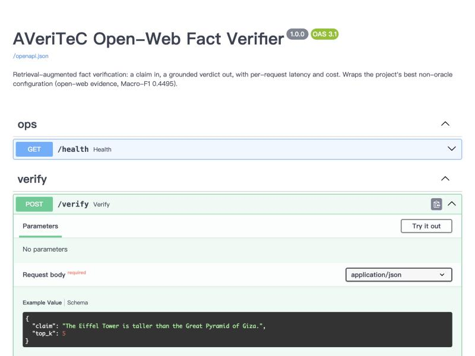

# What Actually Drives Retrieval-Augmented Fact Verification?

**A controlled study on AVeriTeC showing that *where* evidence comes from matters far more than *how* it is retrieved.**

Fact-checking with retrieval-augmented LLMs has three tunable components — the **evidence source**, the **prompt**, and the **retrieval strategy** — and most research pours effort into the last one (dense retrievers, query reformulation, decomposition). This project asks: *which one actually moves the needle?* By decoupling the pipeline and caching every stage, each experiment changes exactly one component, cleanly isolating its effect on 4-class veracity prediction (Supported / Refuted / Not Enough Evidence / Conflicting).

### Headline result

> **Evidence Source ≫ Prompt Design > Retrieval Strategy**

Climbing an evidence-availability ladder on the official 500-claim dev set (Macro-F1):

| Configuration | Macro-F1 | |
|---|---|---|
| Averaged Perceptron (no evidence) | 0.3546 | traditional baseline |
| LLM zero-shot (no evidence) | 0.3365 | reasoning alone isn't the bottleneck |
| BM25 closed-web + plain prompt | 0.3644 | curated Knowledge Store |
| **DuckDuckGo open-web + plain prompt** | **0.4495** | **+0.085, McNemar p = 2.5e-7** |
| Gold evidence (oracle) | 0.5633 | upper bound |

Switching the **evidence source** (closed → open web) gives the single largest gain (+0.085, statistically significant), closing 43% of the gap to the oracle ceiling. In contrast, swapping the **retrieval architecture** (BM25 → dense re-ranking) moves Macro-F1 by just −0.007 (within noise), and sophisticated query reformulation *hurts* (keyword −0.035, decomposition −0.042). A simpler **prompt** reliably adds a secondary +0.03–0.04 across both evidence sources.

The retrieval result replicates on the stronger evidence rung: hybrid retrieval (BM25 + dense fused by RRF) and cross-encoder re-ranking over a widened open-web pool land at **p = 1.0 and p = 0.86** against the deployed baseline — [see the null result and the control that nearly hid it](#does-better-ranking-help-a-pre-registered-null-result).

An **oracle-gap error analysis** (quantitative decomposition + 20-case qualitative study, cross-verified by 3 independent LLM annotators) traces the residual error to the Conflicting class (54.6% of the gap) and an annotation-convention mismatch — and shows ~20% of the gap is irreducible annotation ambiguity, i.e. the gold ceiling is not ground truth.

**Stack:** Python · BM25 (rank-bm25) · sentence-transformers (mpnet) · DuckDuckGo · Azure OpenAI (`gpt-4.1-mini`) · FastAPI · Docker · scikit-learn · NLTK

## Full results

All configurations on the official 500-claim dev set (Macro-F1 + per-class F1). Regenerate this table from the committed caches with `python src/make_results_table.py` — no API calls needed.

| Evidence | Configuration | Macro-F1 | Supported F1 | Refuted F1 | NEE F1 | Conflicting F1 | n |
|---|---|---|---|---|---|---|---|
| No evidence | Majority baseline | 0.1894 | 0.000 | 0.758 | 0.000 | 0.000 | 500 |
|  | Random baseline | 0.1929 | 0.201 | 0.384 | 0.069 | 0.118 | 500 |
|  | Averaged Perceptron | 0.3546 | 0.357 | 0.758 | 0.218 | 0.085 | 500 |
|  | LLM zero-shot (no retrieval) | 0.3365 | 0.551 | 0.578 | 0.174 | 0.043 | 500 |
| Closed web | BM25 + plain prompt | 0.3644 | 0.558 | 0.596 | 0.150 | 0.154 | 500 |
|  | Dense rerank + plain prompt | 0.3572 | 0.570 | 0.645 | 0.178 | 0.036 | 500 |
|  | BM25 + 8-shot ICL | 0.3754 | 0.541 | 0.632 | 0.102 | **0.226** | 500 |
| Open web | DuckDuckGo + standard prompt | 0.4180 | 0.674 | 0.659 | 0.214 | 0.125 | 500 |
|  | **DuckDuckGo + plain prompt** | **0.4495** | 0.712 | 0.711 | 0.237 | 0.138 | 500 |
| Oracle | Gold evidence | 0.5633 | 0.858 | 0.862 | 0.487 | 0.045 | 500 |

Reading down the three evidence rungs (closed → open → oracle) is the main result; the two prompt rows under *Open web* isolate the prompt effect at a fixed source; *Dense rerank* and *8-shot ICL* are the retrieval- and prompt-side ablations. Even under gold evidence, the **Conflicting** class stays near zero (F1 0.045) — the motivation for the error analysis below.

## Faithfulness (is the verdict grounded, or hallucinated?)

Macro-F1 measures whether a verdict is **correct**; it says nothing about whether the verdict is **grounded in the evidence actually retrieved**. A fact-checker that guesses right from the model's parametric memory is still unsafe. `src/rag_eval.py` adds a RAGAS-style **faithfulness** metric via an LLM-as-judge: given *only* the retrieved evidence and the system's verdict, is that verdict justified?

Faithfulness across the full evidence ladder (all 500 official dev claims, judge = `gpt-4.1-mini`):

| Verdict | Closed-web (BM25) | Open-web (DDG) | Gold (oracle) |
|---|---|---|---|
| Supported | 0.726 | 0.803 | 0.800 |
| Refuted | 0.760 | 0.861 | 0.884 |
| NEE | 0.484 | 0.522 | 0.659 |
| Conflicting | 0.500 | 0.600 | 0.667 |
| **Overall** | **0.637** | **0.753** | **0.822** |

<sub>Judged on 487 / 485 / 488 claims respectively; 9–12 per config are dropped where Azure's content filter blocks the judge call. Faithfulness is the share of verdicts the judge rules justified *by the evidence shown* (not by real-world truth).</sub>

Two findings this adds on top of accuracy:

1. **Faithfulness climbs the same evidence ladder as accuracy** — 0.637 → 0.753 → 0.822, mirroring Macro-F1's 0.364 → 0.450 → 0.563. Better evidence doesn't just make the system *more often right*, it makes its verdicts *better grounded*: the single most effective accuracy lever (swapping the evidence source) is also the most effective faithfulness lever. The closed-web system is unfaithful on ~36% of its verdicts — asserting support or refutation the Knowledge Store does not actually contain — and moving to the open web closes a third of that gap (+0.12 faithfulness).
2. **"Not enough evidence" is the least-grounded verdict at every rung** (0.48 → 0.52 → 0.66). It improves with better evidence, but stays lowest *even under gold evidence* — a third of gold-NEE verdicts are still unjustified — so the NEE weakness is partly a reasoning limit, not purely a retrieval one. Notably this is a *different* weak spot from the one accuracy analysis finds: the oracle gap is dominated by the **Conflicting** class (54.6% of it, see below), whereas the grounding deficit concentrates on **NEE**. Measuring faithfulness therefore surfaces a failure mode Macro-F1 alone does not expose.

Reproduce (the gold column first materializes gold QA pairs into retrieval-cache shape, then runs the same judge):

```bash
# Open-web column
python src/rag_eval.py \
    --retrieval-cache results/ddg_direct_dev500_retrieval_cache.json \
    --prediction-cache results/ddg_direct_dev500_plain_eval_cache.json \
    --output-cache results/faithfulness_ddg_plain_dev500.json

# Gold (oracle) column
python src/build_gold_evidence_cache.py \
    --data-file data/dev.json \
    --output-cache results/gold_evidence_dev500_retrieval_cache.json
python src/rag_eval.py \
    --retrieval-cache results/gold_evidence_dev500_retrieval_cache.json \
    --prediction-cache results/gold_baseline_official_dev_with_metadata_cache.json \
    --output-cache results/faithfulness_gold_plain_dev500.json
```

## Does better ranking help? A pre-registered null result

The headline claims retrieval strategy matters least. That was shown on the *closed* Knowledge Store, where a weak source could plausibly have masked a good ranker. This section tests the claim where it is hardest to dismiss: on the **open web**, the stronger source and the one the live service actually uses.

`src/hybrid_retrieval.py` widens the candidate pool from 5 to ~16 hits per claim and re-ranks it five ways — the engine's own order, Okapi BM25, dense cosine (mpnet), **Reciprocal Rank Fusion** of all three, and RRF followed by a **cross-encoder** (`ms-marco-MiniLM-L-12-v2`). Every variant reads the *same* cached pool, so a difference comes from ranking alone and not from different pages having been fetched on a different day.

Pilot on 150 dev claims, identical plain prompt throughout, significance by exact McNemar on accuracy (content-filtered claims excluded; `n` varies with the union of refusals):

| Ranking | Macro-F1 | Accuracy | NEE predicted | Conflicting predicted | vs. baseline |
|---|---|---|---|---|---|
| **Deployed baseline** (DDG top-5, narrow fetch) | 0.4171 | 0.6164 | 29 | 4 | — |
| Wide pool, engine order | 0.3537 | 0.5548 | 34 | 2 | −0.063, p = 0.14 |
| RRF (engine + BM25 + dense) | 0.4207 | 0.6164 | 20 | 10 | +0.004, **p = 1.0** |
| RRF + cross-encoder | 0.4440 | 0.6233 | 17 | 9 | +0.027, p = 0.86 |

**Hybrid retrieval buys nothing here.** RRF lands on *exactly* baseline accuracy (12 claims each way, p = 1.0); the cross-encoder adds a Macro-F1 point or three that does not survive the test. On this evidence rung too, retrieval strategy is the lever that does not move.

Three things are worth more than the null itself:

**The control you pick decides the answer.** Asking DuckDuckGo for 30 results makes its *own top 5 worse* than asking for 5 (Macro-F1 0.4171 → 0.3537, −0.062 accuracy). Scored against that wide-pool head — the control a "pool then re-rank" study reaches for by default — re-ranking looks like a solid **+0.065 to +0.090 Macro-F1**. Scored against the system actually deployed, it is ~0.00 to +0.027 and insignificant. The same runs, a 2–3× difference in the apparent gain, and only the second comparison answers "should I ship this?". The in-pool control is reported above as *Wide pool, engine order* rather than quietly dropped.

**Re-ranking does change behaviour — just not accuracy.** Every re-ranked variant cuts over-prediction of *not enough evidence* (29 → 17) and roughly doubles *Conflicting* predictions (4 → 9). The movement is real and consistent; it lands in the two rare classes, which is why Macro-F1 shifts while accuracy does not.

**A broken model is not a null result.** The first run had `rrf_ce` byte-identical to `rrf` across all 150 claims. The cause was not re-ranking being useless: `ms-marco-MiniLM-L-6-v2` emits NaN from its first encoder block in this environment, NaN compares `False` against everything, so `sorted()` returned its input and the re-ranker became the identity function — while running to completion and printing a plausible table. `assert_cross_encoder_works()` now rejects NaN, constant and inverted scorers at startup, and a per-call guard raises. Before reporting "no difference", prove the intervention changed its input.

### Reducing unjustified "not enough evidence"

The faithfulness analysis flagged NEE as the least-grounded class. Quantified on dev500: the open-web system answers *not enough evidence* on **116 claims where only 18 truly are** — 84% of its NEE verdicts are wrong. `--prompt-style nee_guard` adds one paragraph defining when the label is warranted (evidence *silent* on the claim, not merely incomplete).

Full dev500, 491 claims after excluding content-filter refusals:

| Prompt | Macro-F1 | Accuracy | NEE predicted | Refuted F1 |
|---|---|---|---|---|
| plain | 0.4499 | 0.6049 | 116 | 0.711 |
| plain + NEE guard | 0.4611 | 0.6293 | 95 | 0.745 |

**+0.024 accuracy at p = 0.050 — borderline, and not claimed as significant.** The mechanism is the interesting part: of the 25 claims pushed off NEE, **14 become correct**, and **17 of the 25 were gold *Refuted*** — the guard mostly recovers refutations the model was hedging on, which is where the Refuted F1 gain comes from. Cost, as predicted: NEE's own F1 slips 0.238 → 0.231.

Two side effects worth recording. The longer prompt tripped Azure's content filter on 5 more claims (3 → 8 refusals); those are moderation decisions, not reasoning errors, so `compare_runs.py --exclude-filtered` drops the union and **both versions are reported** (without exclusion: +0.016 accuracy, p = 0.26). And the two NEE interventions **do not stack** — combining re-ranking with the guard drives NEE predictions down to 11, lifts accuracy +0.027, but returns Macro-F1 to baseline (−0.001) because true NEE recall collapses (F1 0.105). Two independently helpful suppressors over-correct together.

**Nothing from this week was shipped into `src/service.py`.** No variant cleared significance against the deployed configuration, and the honest conclusion is to leave a working system alone.

```bash
# 1. candidate pool (network-bound, ~20 min for 150 claims; cached per query)
python src/hybrid_retrieval.py --data-file data/dev.json --sample 150 \
    --pool-file results/hybrid_dev150_pool30.json --pool-only

# 2. all five rankings from that pool (no network)
python src/hybrid_retrieval.py --data-file data/dev.json --sample 150 \
    --pool-file results/hybrid_dev150_pool30.json \
    --out-prefix results/hybrid_dev150

# 3. score each under the same prompt, then compare with significance
python src/reprompt_eval.py --data-file data/dev.json \
    --retrieval-cache results/hybrid_dev150_rrf_ce_retrieval_cache.json \
    --output-cache    results/hybrid_dev150_rrf_ce_eval_cache.json
python src/compare_runs.py --restrict-to-common --exclude-filtered \
    --caches results/ddg_direct_dev500_plain_eval_cache.json \
             results/hybrid_dev150_rrf_ce_eval_cache.json \
    --labels baseline rrf_ce
```

## Live service (`POST /verify`)

The evaluated open-web pipeline is also exposed as a small **FastAPI** service, so a claim can be verified over HTTP and get back a grounded verdict with its evidence, latency and cost. The service calls the *same* retrieval, prompt and LLM code as the experiments (`src/service.py` is a thin wrapper), so what it serves is the project's best non-oracle configuration, not a re-implementation.

```bash
uvicorn src.service:app --port 8000      # then open http://localhost:8000/docs
```



```bash
curl -s -X POST http://localhost:8000/verify \
  -H "Content-Type: application/json" \
  -d '{"claim": "The Eiffel Tower is taller than the Great Pyramid of Giza."}'
```

```json
{
  "verdict": "supported",
  "verdict_label": "Supported",
  "evidence": [
    {
      "url": "https://www.britannica.com/topic/Eiffel-Tower-Paris-France",
      "title": "Eiffel Tower | History, Height, & Facts | Britannica",
      "snippet": "...it was twice as high as the dome of St. Peter's in Rome or the Great Pyramid of Giza..."
    }
  ],
  "n_evidence": 5,
  "latency": { "retrieval_ms": 7173.6, "llm_ms": 1475.7, "total_ms": 8649.3 },
  "usage": { "prompt_tokens": 598, "completion_tokens": 1, "cost_usd": 0.000241 }
}
```

- **`POST /verify`** — claim → open-web retrieval → LLM → grounded verdict + evidence, **timed and costed per request**. Request is Pydantic-validated (`claim` 3–2000 chars, `top_k` 1–10).
- **`GET /health`** — liveness, and which model/evidence source is wired.
- **`GET /docs`** — interactive Swagger UI (shown above).

`tests/test_service.py` mocks retrieval and the LLM, so the service is tested with no network or credentials. Measured latency and cost are in **Measured performance** below.

## Running in Docker

```bash
cp .env.example .env        # add your Azure OpenAI credentials
docker compose up --build
```

```bash
curl -s -X POST http://localhost:8000/verify \
  -H 'Content-Type: application/json' \
  -d '{"claim": "The Eiffel Tower is taller than the Great Pyramid of Giza."}'
```

Three deliberate choices in the image:

- **A slim runtime dependency set.** It installs `requirements-service.txt`, not `requirements.txt`: `sentence-transformers`/`torch` are pulled in only by `dense_rerank.py`, a retrieval ablation the service never imports. Leaving them out keeps the built image at **873 MB**.
- **NLTK corpora baked in.** `bm25_baseline.py` builds a stopword set *at import time*, so without them the service raises `LookupError` on startup — and the non-root user could not download them at run time.
- **Secrets stay out.** Credentials are read from `.env` at run time; `.dockerignore` keeps `.env`, the 20 MB `data/` directory and all caches out of the build context.

The container runs as a non-root user, declares a `/health` healthcheck, and keeps the per-query search cache in a named volume so restarts start warm.

Verified on the built image: it reports `healthy`, runs as uid 10001, answers `POST /verify` end to end, and the cache volume survives `docker compose restart` — retrieval on a repeated claim drops from 7 796 ms to 0.5 ms.

## Measured performance

`src/benchmark.py` drives the running service over HTTP and reports a distribution rather than one lucky request. 20 dev claims, two passes — the second hits the warm search cache:

| Pass | Retrieval p50 | Retrieval p95 | LLM p50 | LLM p95 | Total p50 | Total p95 |
|---|---|---|---|---|---|---|
| Cold | 6 643 ms | 7 628 ms | 1 142 ms | 1 842 ms | 8 168 ms | 9 131 ms |
| Warm | 2 ms | 2 ms | 971 ms | 1 357 ms | **972 ms** | **1 358 ms** |

Cost is unaffected by caching, since the LLM call still runs: **\$0.000240 per claim** — about **\$0.24 per 1 000 verifications** — at ~590 prompt tokens and a one-token completion. 40/40 requests succeeded.

Two things this makes concrete:

1. **Retrieval, not the model, is the cold-path bottleneck** — 81% of total latency. That is a deliberate trade: open-web search is throttled to stay ban-safe.
2. **The cache is worth 8.4× end to end** (8 168 → 972 ms p50). Once warm the service is LLM-bound and sub-second at p50, which is what a deployment with repeat traffic would actually see.

```bash
uvicorn src.service:app --port 8000
python src/benchmark.py --n 20 --repeat --out results/benchmark.json
```

## Setup

```bash
pip install -r requirements.txt
python -c "import nltk; nltk.download('punkt'); nltk.download('stopwords')"
```

Create a `.env` in this directory with Azure OpenAI credentials (never committed):

```
AZURE_OPENAI_ENDPOINT=...
AZURE_OPENAI_API_KEY=...
AZURE_OPENAI_DEPLOYMENT=gpt-4.1-mini
```

## Data

All AVeriTeC splits used by the reported experiments are committed under `data/` (~20 MB total), so the repo reproduces out of the box:

- `train.json`, `dev.json` — official AVeriTeC train / dev
- `internal_train.json`, `internal_dev.json` — our stratified split of train (via `src/split_data.py`)
- `internal_dev_sample150.json` — stratified 150-claim ablation subset
- `fewshot_clean8_pragref.json`, `fewshot_template.json` — few-shot ICL artifacts

Only the AVeriTeC **Knowledge Store** (used for closed-web BM25) is not committed due to size — download it via `src/download_ks.py` (kept local).

## How to reproduce the headline numbers

All results are cached in `results/*.json`; the commands below regenerate them. The pipeline is **decoupled**: retrieval writes a cache, then `reprompt_eval.py` runs the LLM on it — so a prompt ablation never re-retrieves.

```bash
# 1. Traditional baseline (no evidence)
python src/train_perceptron.py            # → averaged perceptron, Macro-F1 0.3546
python src/eval_week1_official_500.py

# 2. LLM zero-shot, no retrieval  (metadata is on by default; --sample -1 = full split)
python src/llm_baseline.py --split official_dev --sample -1

# 3. Closed-web: BM25 over the Knowledge Store (retrieval, then LLM)
python src/warmup_dev_corpus.py           # ~10 h, one-time corpus warm-up
python src/bm25_baseline.py --split official_dev --sample -1 --retrieval-only
python src/reprompt_eval.py \
    --data-file data/dev.json \
    --retrieval-cache results/bm25_baseline_official_dev_with_metadata_top5_cache.json \
    --output-cache results/bm25_official_dev_plain_prompt_cache.json   # 0.3644

# 4. Open-web: DuckDuckGo (the +0.085 result)
python src/open_web_baseline.py \
    --data-file data/dev.json \
    --output-cache results/ddg_direct_dev500_retrieval_cache.json --sample -1
python src/reprompt_eval.py \
    --data-file data/dev.json \
    --retrieval-cache results/ddg_direct_dev500_retrieval_cache.json \
    --output-cache results/ddg_direct_dev500_plain_eval_cache.json     # 0.4495

# 5. Oracle upper bound
python src/gold_baseline.py --split official_dev --sample -1           # 0.5633

# 6. Prompt ablation (Finding: plain > standard, replicates across sources)
python src/reprompt_eval.py --data-file data/dev.json \
    --retrieval-cache results/ddg_direct_dev500_retrieval_cache.json \
    --output-cache results/ddg_direct_dev500_standard_eval_cache.json --prompt-style standard

# 7. Error analysis (oracle gap decomposition + qualitative case dump)
python src/analyze_gold_gap.py
python src/prep_gold_gap_cases.py
```

## Tests

Minimal unit tests cover the pure, high-traffic components every reported number depends on — the places where a silent bug would corrupt a published number rather than crash. 44 tests, no network and no model downloads:

```bash
python tests/test_core.py        # pipeline: label normalization, atomic writes, few-shot schema
python tests/test_service.py     # service: validation, verdict mapping, cost arithmetic (fully mocked)
python tests/test_hybrid.py      # RRF maths, BM25 edge cases, re-ranker guards, exact McNemar
# or:  pytest tests/
```

`test_hybrid.py` asserts the McNemar p-values against hand-computed exact binomials, and asserts that a NaN, constant or inverted cross-encoder *raises* instead of silently degrading to the identity ranking — the failure that produced a convincing fake null result here.

## Source layout (`src/`)

**Core pipeline**
- `bm25_baseline.py` — BM25 Okapi retrieval over the Knowledge Store; 3-tier cache, atomic writes, `--retrieval-only` decoupling. The project's backbone.
- `dense_rerank.py` — BM25 prefilter → mpnet bi-encoder rerank → top-5 (retrieval-strategy ablation).
- `open_web_baseline.py` — DuckDuckGo open-web retrieval (direct claim-as-query, top-5); the open-web rung of the evidence ladder.
- `hybrid_retrieval.py` — wide open-web candidate pool, then five rankings over the *same* pool: engine order, BM25, dense, RRF fusion, RRF + cross-encoder. Pool fetch and ranking are separate stages, so every variant is recomputed without touching the network.
- `reprompt_eval.py` — apples-to-apples LLM re-prompting on any retrieval cache; `--prompt-style {plain,standard,nee_guard}`, `--fewshot-file`.
- `service.py` — FastAPI wrapper exposing the open-web pipeline as `POST /verify` (+ `/health`, `/docs`); reuses the retrieval/prompt/LLM functions verbatim.
- `benchmark.py` — drives the running service over HTTP and reports p50/p95 latency per stage and cost per claim (stdlib only; cold vs warm cache).
- `gold_baseline.py` — gold-evidence oracle upper bound.
- `llm_baseline.py` — LLM zero-shot, no retrieval.
- `query_generator.py` — query strategies A (direct) / B (keyword) / C (decompose).

**Traditional baseline (no-evidence anchor)**
- `perceptron.py`, `train_perceptron.py`, `features.py`, `dataset.py`, `dummy_baselines.py`

**Evaluation & analysis**
- `rag_eval.py` — RAGAS-style faithfulness/groundedness metric via LLM-as-judge (is the verdict justified by the retrieved evidence?), with 429 back-off and resumable caching.
- `build_gold_evidence_cache.py` — materializes gold QA pairs into retrieval-cache shape so the oracle config can be scored for faithfulness with the same judge.
- `compare_runs.py` — scores any set of eval caches side by side and runs an **exact McNemar** test against the first; `--restrict-to-common` (never compare across different claim sets) and `--exclude-filtered` (don't charge a variant for a content-filter refusal).
- `make_results_table.py` — scores every prediction cache and regenerates the full results table above (no API calls)
- `evaluate_retrieval.py` (URL Recall@5), `evaluate_text_overlap.py` (text-overlap recall + permutation null)
- `analyze_gold_gap.py` — oracle gap decomposition (quantitative)
- `prep_gold_gap_cases.py` — samples gold-wrong cases for qualitative 4-way classification
- `error_analysis.py`, `eval_week1_150.py`, `eval_week1_official_500.py`

**Few-shot ICL**
- `fewshot_picker_clean.py` — Leakage-free few-shot example selector. Draws examples only from `internal_train` and strictly excludes any claims that overlap with the evaluation splits.

**Data prep & infra**
- `split_data.py`, `sample_stratified.py`, `explore_averitec.py`, `create_mini_dev.py`, `download_ks.py`, `download_mini.py`
- `warmup_dev_corpus.py` (parallel corpus tokenization), `warmup_progress.py`
- `run_llm_150.py`, `run_gold_150.py` — sample150 wrappers.

## Notes

- All LLM calls use `gpt-4.1-mini` at temperature 0. Some run-to-run variation (~±0.01 Macro-F1) remains, concentrated in the sparse Conflicting class; differences ≤ 0.01 are treated as noise.
- Ablations follow a **Rule of 150**: piloted on the stratified `internal_dev_sample150.json` before a single confirmation run on dev500.
- Large regeneratable caches (BM25 corpus/rankings, DDG snippets, large retrieval caches) are git-ignored; the small prediction/eval caches that back the reported numbers are committed under `results/`.
